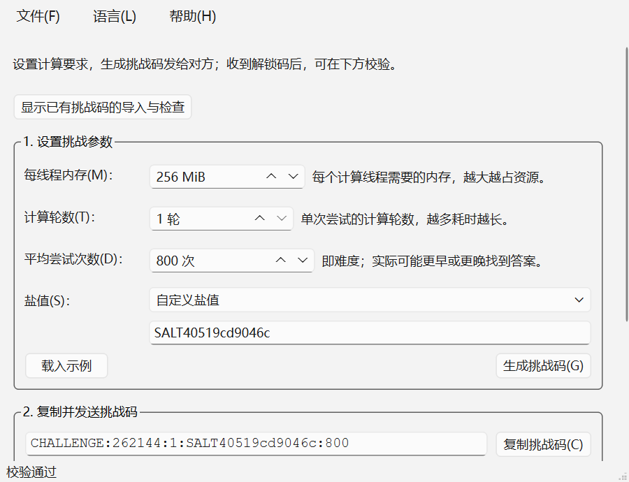
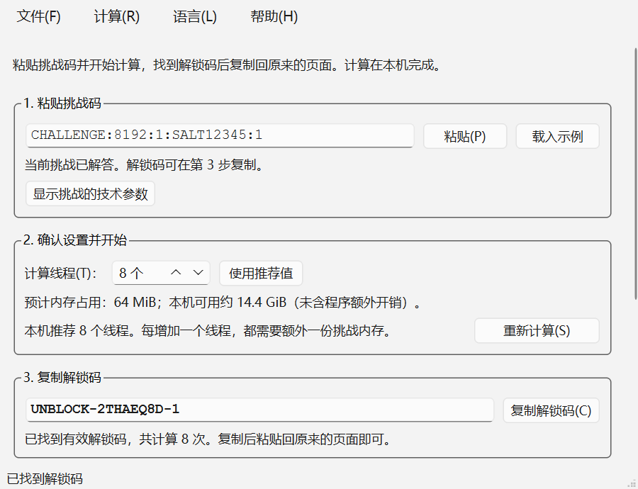

# Argon2 PoW · 出题端 / 解答端

两个独立的 Qt Widgets 桌面程序：

- **出题端** `Argon2PoW-Challenge.exe`：设置 Argon2 参数和概率难度，生成挑战码。
- **解答端** `Argon2PoW-Solver.exe`：粘贴挑战码，搜索满足条件的 `UNBLOCK-...` 解锁码。

界面使用 Qt 原生控件（`QGroupBox`、`QFormLayout`、`QScrollArea`、`QMenuBar`、`QStatusBar` 等），由平台 `QStyle` 绘制；没有使用 QML、WebEngine、自定义全局样式表或自绘装饰。两个窗口按操作步骤从上到下排列，技术参数默认收起。启动时默认采用最小可用窗口尺寸（600×460 逻辑像素，随系统缩放），内容超出时可滚动查看，也可手动放大窗口。





## 与参考脚本的兼容性

挑战码格式与脚本完全一致：

```text
CHALLENGE:<内存 KiB>:<时间成本>:<盐>:<难度>
```

解答端的计算规则：

- 使用 **Argon2id**，版本 `19`（`0x13`），并行度 `p = 1`，输出 32 字节。
- 密码为 `UNBLOCK-XXXXXXXX-<n>`，其中 `XXXXXXXX` 是每次搜索开始时生成的 8 位随机大写字母/数字，`n` 从 `1` 开始递增。
- 盐按原样作为 ASCII/UTF-8 字节传入，不做 Base64 解码。
- 取 32 字节哈希的**前 4 字节**，按**大端**解释为 32 位整数。
- 通过条件：`哈希前缀 < round(2^32 / 难度)`；其中 `round` 对应参考脚本中的 `printf "%.0f"`。

示例：

```text
CHALLENGE:262144:1:SALT40519cd9046c:800
UNBLOCK-G5G75SJH-832
```

该解锁码的 Argon2id 哈希为：

```text
000ca36f2cee96b2851dbc20d5c5a46f
b6451c35aa87df0e9c0cf13147edd2de
```

前缀 `000ca36f` = 十进制 `828271`，小于阈值 `5368709`，因此校验通过。`pow_tests` 会逐字节校验这个结果；另外已确认在示例前缀下，序号 `1`–`831` 都不满足条件，`832` 是第一个有效解。

> 提示：解答端每次使用新的随机前缀，因此对同一个挑战码得到的具体序号通常与示例不同；只要满足上述规则，站点即可接受。

## 功能

### 出题端

- 设置内存成本（MiB，内部转换为 KiB）、时间成本、期望尝试次数（难度）。
- 支持导入已有挑战码，检查格式与参数范围，反查并回填内存、轮数、盐值和难度；完整保留 KiB 精度与原盐值。
- 随机盐（`SALT` + 12 位十六进制）或自定义盐。
- 生成并复制挑战码。
- 技术参数可按需展开，查看当前挑战的参数摘要和通过阈值。
- 参数修改后，暂停复制和校验并提示重新生成，避免使用旧挑战码。
- 在后台本地校验提交的 `UNBLOCK-...` 解锁码，校验期间仍可操作界面；输入修改后不会显示旧校验结果。
- “载入示例”会填入题目中的示例参数并自动校验示例答案。

已有挑战码的操作：

1. 点击窗口顶部“显示已有挑战码的导入与检查”（或按 `Ctrl+I`）。
2. 粘贴 `CHALLENGE:...`，点击“导入并检查”或按 Enter。
3. 检查通过后，下方设置会还原该挑战的参数，第 2 步显示当前挑战码。导入失败会显示原因，并保留原挑战。
4. 在第 3 步粘贴对方的 `UNBLOCK-...` 解锁码，再点击“校验解锁码”或按 Enter。

“导入检查通过”表示格式与参数合法；只有解锁码通过 Argon2 计算校验，才表示它是该挑战的有效答案。反查参数是读取挑战码中已经包含的信息。

### 解答端

- 一键粘贴并自动解析挑战码；技术参数可按需展开查看。
- 可调计算线程数，支持一键恢复推荐值；界面会按本机可用内存给出建议并估算内存占用。
- 显示已尝试次数、速率、已用时间、平均等待估算和累计命中机会。运行时用活动指示条表示正在计算，不显示固定完成百分比。
- 平均等待估算为“难度 ÷ 当前速率”，不是倒计时；超过平均次数仍可能继续搜索。
- 可随时停止；停止会等待当前批次哈希结束。
- 找到后显示解锁码、命中次数和哈希前缀，可一键复制。
- 搜索按序号顺序提交最早命中的解，与单线程参考脚本的语义一致；多线程只是并行计算一个批次内的候选。
- 输入框内按 Enter 开始解答，`F5` 开始或停止，`Ctrl+L` 定位并选中挑战码。

## 构建

要求：

- Qt 6.5 或更高版本（Widgets 和 LinguistTools 模块）。
- CMake 3.21+。
- Ninja（推荐）。
- 与 Qt 套件匹配的编译器：MinGW 13.1 或 MSVC 2019+。

Windows + Qt MinGW 一键构建：

```powershell
.\scripts\build.ps1
```

默认使用 `C:\Qt\6.12.0\mingw_64` 和 `C:\Qt\Tools\mingw1310_64`。如果安装位置不同：

```powershell
.\scripts\build.ps1 -QtDir "D:\Qt\6.8.3\mingw_64" -MingwDir "D:\Qt\Tools\mingw1310_64"
```

手动构建：

```powershell
cmake -S . -B build -G Ninja `
  -DCMAKE_BUILD_TYPE=Release `
  -DCMAKE_PREFIX_PATH="C:\Qt\6.12.0\mingw_64" `
  -DCMAKE_C_COMPILER="C:\Qt\Tools\mingw1310_64\bin\gcc.exe" `
  -DCMAKE_CXX_COMPILER="C:\Qt\Tools\mingw1310_64\bin\g++.exe"
cmake --build build
ctest --test-dir build --output-on-failure
```

生成的程序：

```text
build\Argon2PoW-Challenge.exe
build\Argon2PoW-Solver.exe
```

## 打包

```powershell
.\scripts\deploy.ps1
```

生成两个完全独立的 Windows x64 便携包，各自包含所需运行库，不依赖另一个程序：

```text
dist\Argon2PoW-Challenge\
dist\Argon2PoW-Solver\
dist\Argon2PoW-Challenge-windows-x64.zip
dist\Argon2PoW-Solver-windows-x64.zip
```

分别将 ZIP 发送到对应电脑，解压完整目录后运行其中的 EXE，不需要安装 Qt 或 MinGW。不要只复制 EXE。这些 Windows 二进制不能直接在 Linux/macOS 上运行，其他操作系统需在对应平台单独构建。

打包保留 Qt Core、Gui、Widgets、Windows 平台和原生样式插件，以及中文控件翻译；移除未使用的 Network、Svg、图片插件和其他语言资源。只剥离自身 EXE 的无用符号，保持 Qt DLL 完整。每次先在临时目录准备文件，再替换已生成的包，避免残留旧依赖。体积统计写入 `dist/package-sizes.json`。

独立运行验证（移除 PATH 中的 Qt/MinGW，并限制插件来源到当前包）：

```powershell
.\scripts\test-packages.ps1
```

## 国际化（i18n）

支持简体中文和 English，默认跟随系统语言；非中文系统使用 English。菜单“语言 / Language”可保存语言偏好，重新启动后生效。界面文案、无障碍名称、工具提示、算法错误与时间单位都使用 Qt 翻译机制；数字格式随语言区域设置变化，挑战码和解锁码协议始终保持原样。

两端都可用命令行临时覆盖语言，不修改已保存的偏好：

```powershell
.\Argon2PoW-Challenge.exe --lang en
.\Argon2PoW-Solver.exe --lang zh_CN
```

源码语言为简体中文，英文目录为 `translations/argon2pow_en.ts`。CMake 使用 `lrelease` 将翻译编译并嵌入 EXE；Qt 自带控件的中文翻译单独打包为 `translations/qtbase_zh_CN.qm`。新增文案后执行以下命令，再用 Qt Linguist 补全翻译：

```powershell
.\scripts\update-translations.ps1
```

`i18n_tests` 检查目录完整性、占位符和语言切换；中英文界面分别运行交互测试。构建时可用 `-DBUILD_TESTING=OFF` 关闭测试目标。

## 命令行

解答端可以直接接收挑战码：

```powershell
.\Argon2PoW-Solver.exe "CHALLENGE:262144:1:SALT40519cd9046c:800"
```

开发/截图辅助参数：

```text
出题端: --example --screenshot <png> [--screenshot-delay <ms>]
解答端: --auto-start --screenshot <png> [--screenshot-delay <ms>]
```

## 实现说明

- `third_party/argon2/` 内置 Argon2 官方参考实现（提交 `f57e61e`），静态链接进两个程序。
- x86-64 使用参考实现自带的优化路径 `opt.c`；其他架构回退到 `ref.c`。
- 搜索采用“有序批次”：每批最多启动 `线程数` 个候选，全部完成后选择序号最小的命中项，因此不会因为线程调度而返回更晚的解。
- 每个线程独立分配一份 Argon2 内存，峰值内存约为 `线程数 × m`。解答端默认最多 8 线程，并按可用物理内存限制建议值。
- 难度是**期望尝试次数**，不是保证值；概率按 `1 - exp(-尝试次数/难度)` 估算。
- `ui_tests` 覆盖挑战导入与精确回填、无效导入保护、旧参数操作保护、后台校验、解答与停止，以及最小窗口尺寸下的滚动布局。
- 所有计算都在本机完成，不访问网络。

## 目录结构

```text
src/common/pow.*       挑战解析、哈希、校验、线程搜索核心
src/common/ui.*        Qt 原生界面辅助与公共启动参数
src/common/i18n.*      语言选择、翻译加载与语言菜单
src/generator/         出题端
src/solver/            解答端
tests/pow_tests.cpp    算法与搜索测试
tests/ui_tests.cpp     中英文交互与布局测试
tests/i18n_tests.cpp   翻译完整性与加载测试
translations/         Qt Linguist 翻译源文件
third_party/argon2/    Argon2 参考实现
scripts/build.ps1      构建脚本
scripts/deploy.ps1     windeployqt 打包脚本
scripts/test-packages.ps1  独立运行验证
```

## 许可证

本项目采用 **GNU General Public License v3.0**（`GPL-3.0-only`）开源。

你可以自由使用、修改和分发本项目，但分发修改后的版本时必须继续使用 GPL-3.0，并提供对应源代码。完整许可文本见根目录 [LICENSE](LICENSE)。

### 第三方许可

`third_party/argon2/` 中的 Argon2 参考实现仍按其原有许可证提供：CC0 1.0 / Apache 2.0 双许可，详见 `third_party/argon2/LICENSE`。Apache 2.0 与 GPL-3.0 兼容；该第三方代码不改变本项目整体的 GPL-3.0 授权。
